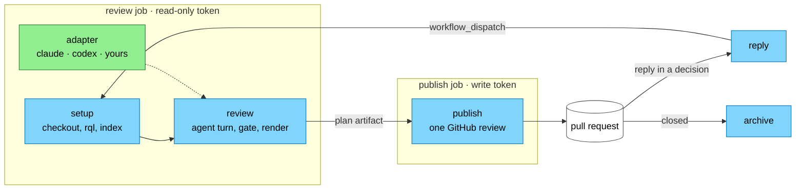

# RepoQL Review Agent

An agent reviews every push to a pull request, using RepoQL to understand the change against the whole codebase. It posts one GitHub review per push. A defect becomes a thread at the line with its proof, and a fix becomes a suggestion. A question only a person can answer becomes a decision thread, and a reply in that thread starts the next review. A re-review continues the same agent session, so the reviewer remembers what it raised and checks each finding again rather than starting over.

The reviewer is **Claude Code**, **Codex**, or **opencode 2**. You can also bring your own agent by writing one adapter.

## Quick start

1. Copy [`starter/review.yml`](starter/review.yml) to `.github/workflows/review.yml` in your repository.
2. Add a secret for the agent: `ANTHROPIC_API_KEY` (or `CLAUDE_CODE_OAUTH_TOKEN` from `claude setup-token`) for Claude Code, `OPENAI_API_KEY` for Codex, or, for opencode, the key of the provider its model comes from (`OPENCODE_API_KEY` for OpenCode Zen).
3. Sign rql in. Either install the RepoQL GitHub App on the repository, which signs rql in through the job's OIDC token, or add a `REPOQL_API_KEY` secret.
4. Fill in the lines marked `CHANGE`. The most useful one is `instructions`: tell the reviewer how your repository builds and tests.

Open a pull request. The `review` job reviews it and the `publish` job posts the review. Comment `/review` to ask for another review, or `/review fresh` for one with no memory of the earlier reviews.

## How it fits together



The reviewer never writes to the pull request. Its job's token is read-only. It hands a plan to the `publish` job, which runs none of the change's code and holds the only token that can write.

| Action | What it does |
|--------|--------------|
| `setup` | Resolves the pull request and refuses one from a fork. Checks out the head with full history, installs rql, serves the checkout, and waits until semantic search is ready. Restores the RepoQL index from the Actions cache. |
| `review` | Installs and signs in the agent, restores its session from the last review of the pull request, and gathers the pull request's threads. Runs one turn under the review kata, then fails the review if the agent made no successful RepoQL call. Renders the record into a plan, redacts credentials, and uploads the plan. |
| `publish` | Posts the plan as one review, replies in earlier threads whose state changed, and sets the `review/verdict` commit status. When the review job failed, it comments that no review was made. |
| `reply` | Starts a review when a person replies in a thread the reviewer opened as a decision. |
| `archive` | Deletes a closed pull request's session from the runner and its session artifacts. |

## Customising

Most teams only change the first row.

| To change | Edit |
|-----------|------|
| What the reviewer knows about your codebase | Your repository's own agent instructions (CLAUDE.md, AGENTS.md) and RepoQL concepts. The reviewer reads them. The `instructions` input adds text to the reviewer's prompt. |
| The agent, the model, the runner, the triggers | The workflow: `agent`, `model` and `agent-args` on the `review` action. |
| The words the reviewer is given | `prompts`: a directory with your own `first.md`, `again.md` and `environment.md`, starting from [the shipped ones](prompts/). |
| How the reviewer thinks | `kata`: a directory with your own `SKILL.md` and `record.md`, starting from [the shipped kata](kata/). |

### Inputs of the review action

| Input | Default | Meaning |
|-------|---------|---------|
| `agent` | `claude` | `claude`, `codex`, `opencode`, or the path of your adapter in the checkout |
| `model` | the agent's default | The model to review with |
| `agent-args` | none | More arguments for the agent's CLI, one per line |
| `instructions` | none | Text added to the reviewer's prompt |
| `session-store` | `artifact` | `artifact` keeps the session as a workflow artifact per pull request, scrubbed of credentials, so a push, a comment and a reply all continue one session. `runner` keeps it in the runner's home directory, for self-hosted runners. `none` starts a new session every time |
| `session-retention-days` | `30` | How long a session artifact is kept |
| `kata`, `prompts` | the shipped ones | Directories that replace them |
| `redact` | none | More secrets to scrub from the uploaded plan, one per line |

The `setup` action takes `pr`, `fresh`, `command` (the comment that asks for a review, `/review` by default), `rql-version`, `cache-index` and `ready-timeout-minutes`.

### Agents and their sandboxes

Claude Code runs with `--permission-mode bypassPermissions`, because a headless turn denies every tool it would otherwise ask about. Claude Code refuses to bypass permissions when it runs as root, so run the job as a normal user, as hosted runners do.

Codex runs with its own default sandbox. On a hosted runner, which is discarded after the job, you can let it build and run tests freely:

```yaml
agent: codex
agent-args: |
  -c
  sandbox_mode="danger-full-access"
  -c
  approval_policy="never"
```

opencode needs version 2; the adapter installs `@opencode/cli` when it finds none or an older one. It runs with `--standalone`, a private server for each command, and `--auto`, which approves each permission request once. Name its model as `provider/model`, such as `anthropic/claude-sonnet-5-5`, and give the job that provider's key. opencode differs from the other two in three ways:

- **It cannot be held to a schema.** The prompt names the record's schema, and the record is the reviewer's final message. An answer that is not a JSON object is published as `undetermined`.
- **It compacts a session itself** as the session grows, so the adapter does not ask it to.
- **Its sessions live in a database.** The adapter gives the reviewer a database of its own, apart from any sign-in a person's opencode keeps, and that database is what the session artifact carries. Redaction masks secrets inside it without changing its length, so it still opens.

## Bringing your own agent

An adapter is one program that knows one agent. [`src/harness/claude.ts`](src/harness/claude.ts), [`src/harness/codex.ts`](src/harness/codex.ts) and [`src/harness/opencode.ts`](src/harness/opencode.ts) are the three that ship. Pass the path of yours, in the checkout, as `agent`. A `.js`, `.mjs`, `.cjs` or `.ts` file runs with Node, which runs TypeScript by stripping its types. A `.py` file runs with `python3`. Any other file runs as an executable.

An adapter takes four commands.

| Command | Must |
|---------|------|
| `prepare` | Install the agent if it is missing. Exit non-zero with an actionable message when it has no credential |
| `state-dirs` | Print, one per line, the directories that must survive between runs for a session to continue |
| `run` | Run one review turn, described below |
| `archive --repo O/R --pr N` | Forget the pull request's session |

`run` is called like this:

```text
run --repo O/R --pr N --head SHA --first first.md --again again.md
    --schema record.schema.json --record record.json
    --events events.jsonl --sight session.json
    [--fresh] [--model M] --rql /path/to/rql -- [agent-args...]
```

It must:

- Start the agent with the repoql MCP server, `<rql> mcp`, as a stdio server.
- On the first review of a pull request, send `first.md` as the prompt. On a later one, continue the earlier session and send `again.md` with `{last_head}` replaced by the head it last reviewed. With `--fresh`, start a new session.
- Ask the agent for a final answer that matches `--schema`, and write it to `--record`. When the answer does not match, write the text anyway; it is published as `undetermined`.
- Write every event the agent emits to `--events`. They are uploaded with the review for debugging.
- Write `--sight` as `{"session": "new" | "continued" | "fresh" | "lost", "last_head": ..., "repoql_calls": N}`. `repoql_calls` counts the repoql tool calls that returned without error. A first review with none fails, because a reviewer that never used RepoQL is the failure the gate exists to catch.
- Exit with the agent's exit code.

The shipped adapters answer the same commands through the bundle, so `node dist/index.js claude run ...` is what a review runs. Copy the fake-process pattern in [`test/claude.test.ts`](test/claude.test.ts) to test a new adapter without starting the agent.

## Working on the pack

The pack is TypeScript, bundled by esbuild into one file, [`dist/index.js`](dist/index.js). Every action runs that bundle as it is committed, with no install, so a change to `src/` must be rebuilt and the bundle committed with it.

```bash
npm ci
npm run check
```

`npm run check` typechecks, runs the tests, rebuilds the bundle, and fails when the committed bundle differs from what the sources build. The `review-agent` workflow runs the same check on every pull request that touches the pack.

## Limits

- **Pull requests from forks are not reviewed.** The reviewer runs the change's code with the job's credentials.
- **The reviewer's approval is a real GitHub approval,** posted by `github-actions[bot]`. Nothing merges on it unless your ruleset says so. Require the `review/verdict` status if you want the reviewer's verdict to gate merging.
- **The RepoQL index lives in the Actions cache,** which holds 10 GB per repository and is scoped to the ref a run started on. A review started by a comment or a reply runs on the default branch, so it can only restore an index saved there, and may index cold.
- **A session artifact is readable by anyone who can read the repository's runs.** It is scrubbed of the agent, rql and GitHub credentials and of anything in `redact`, but it holds the code and output the reviewer saw.
- **Importing a private repository fails,** because the job's token reads only this repository and public ones. The reviewer lists what it could not check.
